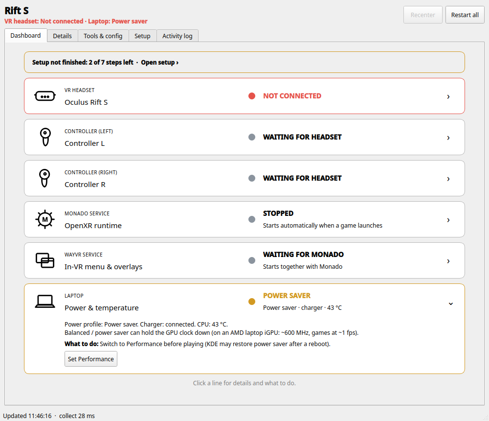
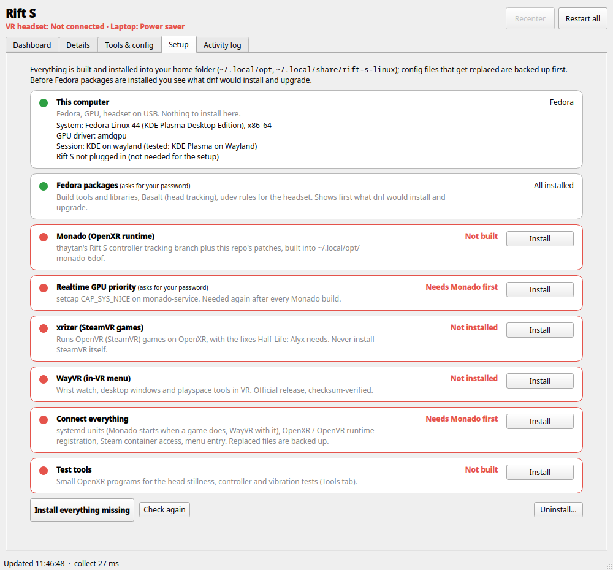
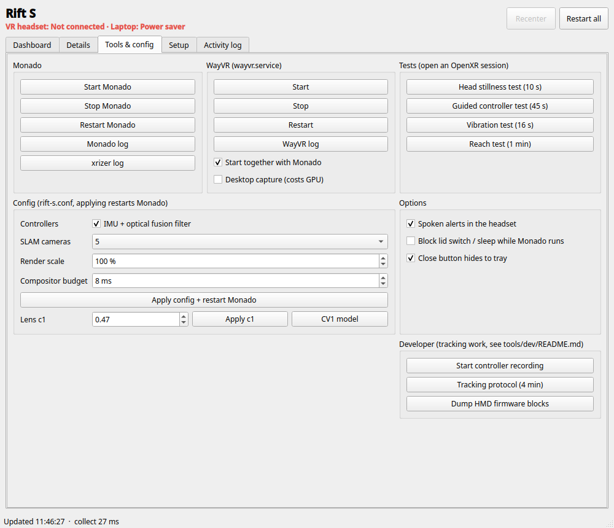

# Rift S on Linux

Play SteamVR and OpenXR games with an **Oculus Rift S on Linux**, with 6DoF head and controller tracking, without SteamVR and without Windows.

This repo bundles a working stack and one window that sets it up and keeps an eye on it:

- **[Monado](https://monado.freedesktop.org/)** as the OpenXR runtime, using [thaytan's Rift S controller tracking branch](https://gitlab.freedesktop.org/thaytan/monado/-/tree/dev-constellation-controller-tracking) plus the patches in this repo: IMU and camera fusion for the controllers, a Rift S lens model, fixed hand and head geometry, vibration, camera passthrough, and a live status file. Several fixes come from [lbgos/rift-s-linux](https://github.com/lbgos/rift-s-linux): the lens model, the grip offsets, driver hardening, and patches for **[Basalt](https://gitlab.freedesktop.org/mateosss/basalt)** (head tracking), which the setup builds too.
- **[xrizer](https://github.com/Supreeeme/xrizer)** so SteamVR (OpenVR) games run on OpenXR, with the fixes Half-Life: Alyx needs.
- **[WayVR](https://github.com/wayvr-org/wayvr)** for the in-VR menu: wrist watch, desktop windows, playspace tools.
- **The status window** (`./rift-s-linux`): a calm dashboard (headset, controllers, Monado, WayVR, power) with one-click fixes, plus a **Setup** tab that installs everything above.

Not affiliated with Meta or Oculus.

<p align="center">
  
  
</p>
<p align="center">
  
</p>
<p align="center"><sub>Dashboard (headset unplugged, one line opened) · Setup on a fresh machine · Tools &amp; config</sub></p>

## Status

Works and is playable: Half-Life: Alyx, Beat Saber (legacy beta, see below).

- 6DoF head tracking (Basalt SLAM) and 6DoF Touch controllers (LED constellation tracking + IMU fusion)
- Direct mode on KDE Plasma Wayland (DRM lease), 1440x2560 @ 80 Hz
- Controller vibration, battery level (shown on WayVR's watch too)
- Camera passthrough: hold the right Oculus button to see the room
- Lens correction fitted to the Oculus runtime's own distortion mesh: straight edges, no morphing
- Rough edges: head tracking can occasionally run away (fix: "Restart all"). Controllers can drop out for a moment in two-hand or near-face poses. Integrated GPUs are at their limit in Alyx.

**Tested on one machine:** Fedora 44, KDE Plasma (Wayland), a Ryzen AI 300 laptop with Radeon 860M integrated graphics. Other Fedora machines with AMD or Intel graphics should work. NVIDIA is untested. The setup only knows Fedora. On other distributions, [docs/manual-setup.md](docs/manual-setup.md) lists the same steps for doing them by hand.

## Quick start

```bash
git clone https://github.com/Kunstbanause/RiftS_Linux.git ~/RiftS_Linux
```

```bash
~/RiftS_Linux/rift-s-linux
```

The first start creates a small Python environment for the window (about 250 MB, inside your home folder). The **Setup** tab then opens by itself. Click **Install everything missing**, enter your password when asked (twice), and wait. Building Basalt and Monado takes 20-60 minutes; close big programs meanwhile, Basalt needs a lot of memory to compile. Then:

1. Log out and back in once, so Steam games can reach Monado.
2. Plug in the headset (USB 3 port plus DisplayPort), power profile **Performance** on a laptop.
3. Start a VR game in Steam. Monado and WayVR start by themselves, and stop when you stop Monado.

The setup adds a menu entry called **Rift S**. The same setup also works in a terminal:

```bash
~/RiftS_Linux/rift-s-linux setup install
```

## What the setup changes

Everything is installed into your home folder. Config files that get replaced are backed up first, and **Uninstall** on the Setup tab (or `rift-s-linux setup uninstall`) puts them back.

| Step | What | Where | Root |
|---|---|---|---|
| Fedora packages | build tools and libraries, `basalt-monado` (head tracking fallback), `xr-hardware` (udev rules for the headset), espeak-ng | system (dnf) | yes |
| Basalt | Monado's Basalt fork at the commit Fedora packages + `patches/basalt`, built from source (at most 3 parallel jobs, it is memory-hungry) | `~/.local/opt/basalt-rifts`, sources in `~/.local/share/rift-s-linux/src` | no |
| Monado | thaytan's branch at a pinned commit + `patches/monado`, built from source | `~/.local/opt/monado-6dof`, sources in `~/.local/share/rift-s-linux/src` | no |
| Realtime GPU priority | `setcap CAP_SYS_NICE` on `monado-service` (again after every rebuild) | that file | yes |
| xrizer | pinned commit + `patches/xrizer`, built with cargo | `~/.local/opt/xrizer` | no |
| WayVR | official release, checksum-checked, AppImage unpacked | `~/.local/opt/wayvr` | no |
| Connect everything | systemd user units (Monado starts on demand, WayVR with it), OpenXR and OpenVR runtime registration, Steam container access, menu entry | `~/.config/systemd/user`, `~/.config/openxr`, `~/.config/openvr`, `~/.config/environment.d`, `~/.local/share/applications` | no |
| Test tools | small OpenXR programs for the tests on the Tools tab | `~/.local/opt/rift-s-linux/bin` | no |

Things it is careful about:

- **No system Qt.** The window uses pip's PySide6 in its own venv (`~/.local/opt/rift-s-linux/venv`). Installing Qt bindings with dnf can pull in a Qt upgrade ahead of Plasma, which once left KDE without a desktop after a reboot.
- **No surprise upgrades.** Before installing packages, the setup asks dnf what it would do and shows it. If that would upgrade desktop or graphics packages (Qt, KDE, Mesa, ...), it warns and recommends a full system update first.
- Your settings in `rift-s.conf` (render scale, lens and so on) are never overwritten by a re-run.
- Fedora packages stay installed on uninstall, because other programs may need them.

## Playing

- **Don't install or start SteamVR.** It takes over the OpenVR registration from xrizer and replaces Monado's compositor. The dashboard turns red if that happened, and the Setup tab fixes it.
- **Recenter:** button in the window or tray menu, or WayVR's playspace reset.
- **Passthrough:** hold the right Oculus button for about 0.6 s, and hold again to go back. WayVR stays on top.
- **WayVR:** left Menu button. Hold to drag the playspace, double click to reset it.
- **After playing:** stop Monado (tray menu), because it keeps about 1.5 CPU cores busy while it runs.
- **Laptops:** use the Performance power profile and keep the charger connected. Balanced can hold an integrated GPU at a fraction of its clock. The dashboard shows a button for this.

Game notes:

- **Half-Life: Alyx** (native Linux version): works with xrizer from this repo. On an integrated GPU these launch options help: `-console +vr_fidelity_level_auto 0 +vr_fidelity_level 0`.
- **Beat Saber** (Proton, OpenXR): the current version shows no menu on Monado. Use the beta branch `legacy1.40.8_unity_v2021.3.16f1` with launch options `OXR_PARALLEL_VIEWS=0 %command%`.

## Updating

```bash
git -C ~/RiftS_Linux pull
```

Then open the Setup tab. Steps with something new show **Update**.

## Similar projects

[lbgos/rift-s-linux](https://github.com/lbgos/rift-s-linux) takes a different route: Monado's Rift S driver inside SteamVR, with more features (SLAM recovery, room setup, IPD, a settings app). This project uses several of their fixes (see Credits). [docs/comparison.md](docs/comparison.md) compares the two area by area, so you can pick what suits your setup.

## More

- [docs/troubleshooting.md](docs/troubleshooting.md): symptoms, causes, fixes
- [docs/configuration.md](docs/configuration.md): settings (render scale, frame budget, lens, vibration, passthrough, recording)
- [docs/patches.md](docs/patches.md): what each patch does
- [docs/manual-setup.md](docs/manual-setup.md): the setup steps as commands
- [docs/comparison.md](docs/comparison.md): this project vs. lbgos/rift-s-linux
- `tools/tour.py`: a guided ~10 min check of the newer fixes (cold starts, CPU load, a controller vanishing mid-vibration, a blind lens A/B), run in a terminal
- [tools/dev/README.md](tools/dev/README.md): tracking analysis tools for developers

## Credits

- **Jan Schmidt (thaytan)** for the Rift S driver and the constellation controller tracking this builds on.
- **lbgos** ([lbgos/rift-s-linux](https://github.com/lbgos/rift-s-linux)) for the work this project took over, under the same licence:
  - the Rift S lens model fitted to the Oculus runtime's distortion mesh, with its lens centres (patch 0017);
  - the Oculus aim and grip offsets (0043);
  - the hardening of the driver and tracker (0018-0039, cherry-picked with their authorship);
  - the Basalt patches (`patches/basalt`);
  - the occlusion motion models (0044).
- **Ryan Ford** ([ryaneford/rift-s-linux](https://github.com/ryaneford/rift-s-linux)) for the controller vibration report format and the camera clock resync fix (0039).
- **The Monado project / Collabora**, and **Basalt** by Vladyslav Usenko, Nikolaus Demmel and co-authors (TU Munich), in Mateo de Mayo's fork for Monado, for SLAM head tracking.
- **xrizer** by Supreeeme, with PR #429 by nokichan.
- **WayVR** by the wayvr-org team.

## License

MIT for the window, setup and tools (see [LICENSE](LICENSE)). The patches are under the licenses of the projects they modify: Boost Software License 1.0 for Monado, BSD 3-Clause for Basalt, GPL v3 for xrizer.
